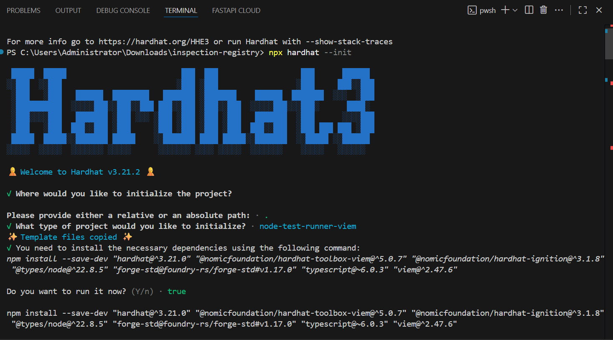
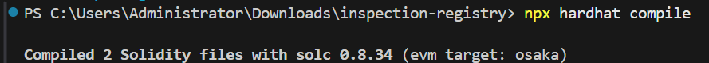
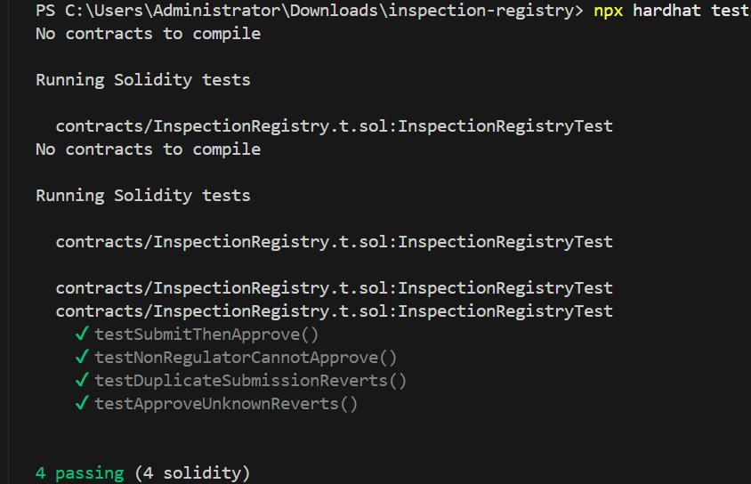

# Laporan Praktikum Minggu ke-9: Smart Contract InspectionRegistry

Implementasi smart contract dasar dengan Solidity, Remix, dan Hardhat 3.

---

## 1. Identitas Mahasiswa

- Nama: Nabila Shandy Nathasa (2313000005)
- Nama: Anisa Kustiawati (2413000006)

---

## 2. Versi Node.js yang Digunakan

- **Node.js:** v22.8.5
- **Hardhat:** v3.21.2
- **Solidity compiler:** 0.8.34
- **Template proyek:** `node-test-runner-viem`

---

## 3. Langkah Instalasi Dependency

Proyek dibuat dengan langkah berikut:

1. Membuka terminal VS Code di folder proyek `inspection-registry`.
2. Menjalankan inisialisasi Hardhat 3, memilih template `node-test-runner-viem`, dan menyetujui instalasi dependency:
   ```powershell
   npx hardhat --init
   ```
3. Menyimpan kontrak di `contracts/InspectionRegistry.sol` dan test di `contracts/InspectionRegistry.t.sol`.

Untuk menjalankan ulang proyek ini dari awal (setelah mengunduh atau mengekstrak), pasang dependency terlebih dahulu:

```powershell
npm install
```

---

## 4. Perintah Compile dan Test

- **Compile contract:**
  ```powershell
  npx hardhat compile
  ```
- **Menjalankan semua test:**
  ```powershell
  npx hardhat test
  ```
- **Menjalankan hanya Solidity test:**
  ```powershell
  npx hardhat test solidity
  ```

---

## 5. Ringkasan Hasil Test

Pengujian memakai file `contracts/InspectionRegistry.t.sol` terhadap kontrak `contracts/InspectionRegistry.sol`. Seluruh test lulus (**4 passing**):

| No | Test | Jenis | Yang dibuktikan |
|---|---|---|---|
| 1 | `testSubmitThenApprove` | Positif | Alur `submit()` oleh vendor lalu `approve()` oleh regulator berhasil, dan data `vendor`, `evidenceHash`, `status`, serta `updatedAt` tersimpan dengan benar. |
| 2 | `testApproveUnknownReverts` | Negatif | `approve()` untuk id yang belum pernah di-submit gagal (revert). |
| 3 | `testDuplicateSubmissionReverts` | Negatif | `submit()` dengan id yang sama untuk kedua kalinya ditolak. |
| 4 | `testNonRegulatorCannotApprove` | Negatif | `approve()` oleh alamat selain regulator gagal, dan status record tetap `SUBMITTED`. |

Test negatif dinyatakan lulus karena kontrak menolak aksi yang tidak valid (`success == false`).

---

## 6. Screenshot dan Output Test

**Inisialisasi proyek (`npx hardhat --init`)**



**Compile (`npx hardhat compile`)**



**Test (`npx hardhat test`)**



**Salinan teks output terminal:**

```text
> npx hardhat compile
Compiled 2 Solidity files with solc 0.8.34 (evm target: osaka)

> npx hardhat test
Running Solidity tests

  contracts/InspectionRegistry.t.sol:InspectionRegistryTest
    ✔ testSubmitThenApprove()
    ✔ testNonRegulatorCannotApprove()
    ✔ testDuplicateSubmissionReverts()
    ✔ testApproveUnknownReverts()

  4 passing (4 solidity)
```

---

## 7. Jawaban Pertanyaan Analisis

### 1. Mengapa `approve()` dan `revoke()` memeriksa `msg.sender`?

Kedua fungsi ini menentukan keabsahan sebuah record inspeksi, sehingga hanya pihak berwenang (regulator) yang boleh memanggilnya. Pemeriksaan `msg.sender != regulator` menjadi access control: transaksi dari alamat lain langsung revert dengan error `Unauthorized()`. Tanpa pemeriksaan ini, vendor dapat menyetujui sendiri inspeksinya, atau pihak lain dapat mencabut status yang sudah disetujui. Dengan begitu invariant utama (record hanya `APPROVED` jika dipanggil oleh regulator) tidak terjaga.

### 2. Mengapa `submit()` memeriksa bahwa status awal harus `NONE`?

Nilai default sebuah entri `mapping` yang belum pernah diisi adalah `Status.NONE` (indeks 0). Syarat `record.status == Status.NONE` memastikan id tersebut benar-benar baru. Jika id yang sama di-submit lagi saat statusnya sudah `SUBMITTED`, `APPROVED`, atau `REVOKED`, transaksi revert dengan `InvalidStatus()`. Akibatnya record lama tidak tertimpa dan alur `NONE -> SUBMITTED -> APPROVED -> REVOKED` tidak bisa dilompati atau diulang.

### 3. Apa yang terjadi pada perubahan state ketika transaksi mengalami revert?

Transaksi bersifat atomik. Saat terjadi revert, seluruh perubahan state yang dilakukan selama eksekusi dibatalkan, sehingga `records[id]` kembali persis seperti sebelum transaksi dikirim. Event yang di-emit dalam transaksi itu juga tidak tercatat. Gas yang sudah terpakai tetap dibayar oleh pengirim, sedangkan gas yang belum terpakai dikembalikan.

### 4. Mengapa dokumen inspeksi tidak disimpan langsung di dalam contract?

Menyimpan data besar (misalnya PDF atau gambar) on-chain membutuhkan biaya gas yang sangat mahal. Dokumen disimpan di luar blockchain (off-chain, misalnya IPFS atau penyimpanan lain), dan kontrak hanya menyimpan `evidenceHash` (`bytes32`) sebagai sidik jari digital. Jika isi dokumen berubah satu karakter saja, hash-nya berubah total dan tidak lagi cocok dengan `evidenceHash` yang tersimpan, sehingga integritas dokumen tetap bisa diverifikasi.

### 5. Apa perbedaan informasi pada `records(id)` dan event log?

- `records(id)` adalah **state** kontrak. Isinya kondisi terakhir sebuah id (vendor, hash bukti, status terbaru, dan waktu pembaruan terakhir). Data ini tersimpan di storage dan dapat dibaca oleh kontrak lain, tetapi biaya menulisnya lebih mahal.
- **Event log** (`InspectionSubmitted` dan `StatusChanged`) adalah catatan **riwayat** setiap perubahan dari waktu ke waktu. Data ini disimpan di log transaksi (lebih murah), tidak dapat dibaca oleh kontrak lain, dan ditujukan untuk aplikasi luar (frontend atau dApp) serta keperluan audit.

---

## 8. Challenge yang Dikerjakan

Pada pengumpulan ini challenge (A, B, atau C) **belum dikerjakan**. Pengerjaan difokuskan pada kontrak dasar sesuai spesifikasi, 4 unit test (satu jalur positif dan tiga jalur negatif), serta dokumentasi hasil.

---

## 9. Satu Keterbatasan Desain

Record yang sudah berstatus `REVOKED` tidak dapat dikirim ulang (*resubmission*) dengan id yang sama, karena `submit()` hanya menerima status awal `NONE`. Vendor harus memakai id baru, sehingga tidak ada keterkaitan resmi antara record lama dan record pengganti di dalam kontrak. Selain itu, `submit()` tidak membatasi siapa yang boleh mengirim, sehingga alamat mana pun dapat bertindak sebagai vendor.

---

## 10. Deklarasi Penggunaan AI Generatif

Kami menggunakan asisten AI generatif (Gemini dan Claude) selama pengerjaan tugas ini, yaitu sebagai pendamping untuk troubleshooting lingkungan WSL2 dan Hardhat, pemeriksaan kelengkapan laporan, serta perapian dokumen. Kode kontrak dan test berasal dari panduan praktikum. Seluruh langkah dijalankan dan diverifikasi sendiri di lingkungan lokal, dan kami memahami isi kode serta jawaban pada laporan ini.

---

## Catatan

Jawaban **Exit Ticket** terdapat pada file terpisah: [`README_Exit_Ticket.md`](README_Exit_Ticket.md).
