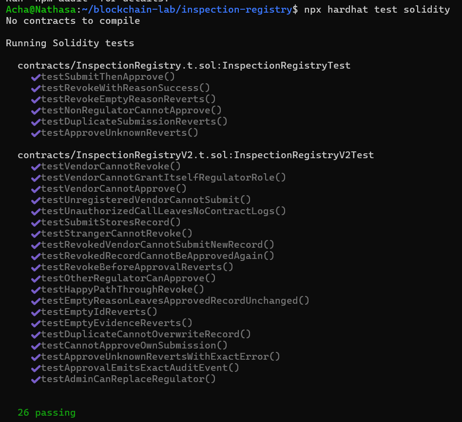
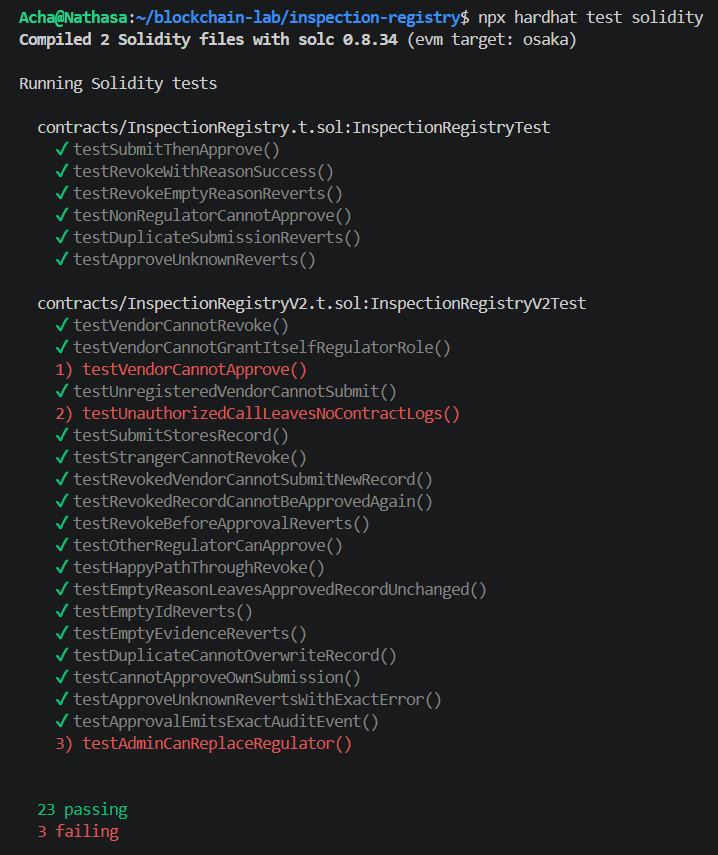
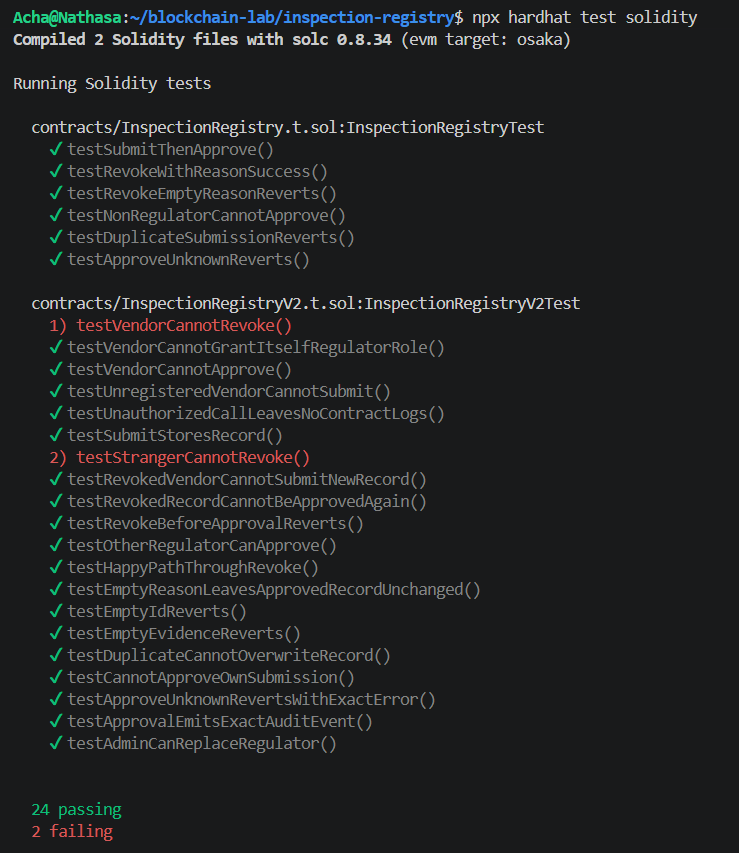
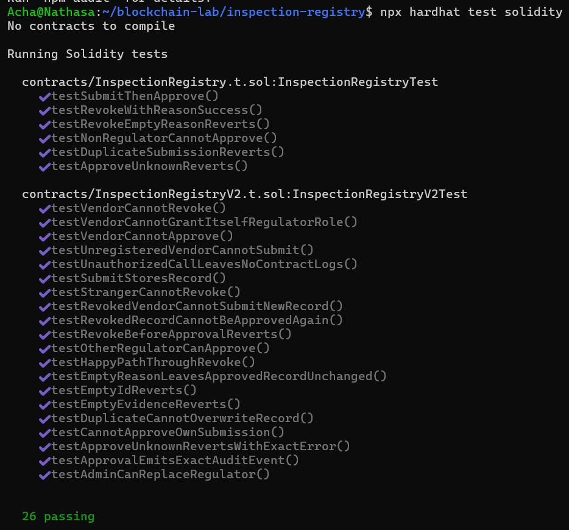
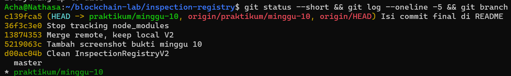

# Praktikum Blockchain Minggu 10: Correctness & Access Control pada InspectionRegistry

## 1. Identitas
- **Nama:** Nabila Shandy Nathasa (2313000005)
- **Nama:** Anisa Kustiawati (2413000006)
- **URL Repo:** https://github.com/nathasa17/inspection-registry
- **Branch:** `praktikum/minggu-10`
- **Commit baseline (V1):** `a741cf18`
- **Commit final (V2):** `36f3c3e0`

## 2. Versi Tools
| Tool | Versi |
|---|---|
| Node.js | v22.23.4 |
| npm | 10.9.9 |
| Hardhat | 3.21.2 |
| Solidity (config) | 0.8.34 (source `^0.8.24`) |
| OpenZeppelin Contracts | 5.4.0 |

## 3. Perintah Eksekusi
```bash
npm ci                          # instal ulang dari package-lock.json
npx hardhat compile             # kompilasi
npx hardhat test solidity       # test Solidity (V1 + V2)
npx hardhat test                # seluruh test proyek
```

## 4. Ringkasan Perubahan V1 ke V2
V1 (`InspectionRegistry.sol`) dan test-nya tidak diubah dan dipertahankan sebagai baseline. V2 (`InspectionRegistryV2.sol`) adalah deployment baru, bukan upgrade proxy, dan tidak memindahkan data V1.

| Aspek | V1 | V2 |
|---|---|---|
| Otorisasi | satu `immutable regulator` | `AccessControl`: admin, vendor, regulator |
| `submit` | semua address | hanya `VENDOR_ROLE` |
| `approve` / `revoke` | `msg.sender == regulator` | `onlyRole(REGULATOR_ROLE)` |
| Cek status | diulang di tiap fungsi | modifier `atStatus(id, expected)` |
| Error | `Unauthorized()`, `InvalidStatus()` tanpa data | error role dari OpenZeppelin; `InvalidStatus(id, expected, actual)`; `ZeroAddress`, `EmptyId`, `SelfApprovalNotAllowed` |
| Event status | `StatusChanged(id, status)` | `StatusChanged(id, from, to, actor)` |
| `revoke` | `revoke(id)` | `revoke(id, reasonHash)`, alasan disimpan di `revocationReasons` |

**ABI yang berubah:** constructor `(admin_, regulator_)` menggantikan `(regulator_)`; `revoke(bytes32,bytes32)`; event `StatusChanged` dan `InspectionRevoked` bertambah field/actor; getter `regulator` hilang, diganti `hasRole`, `grantRole`, `revokeRole`, `VENDOR_ROLE`, `REGULATOR_ROLE`, `revocationReasons`; custom error baru.

## 5. Role Matrix dan State Transition
| Role | submit | approve | revoke | grant/revoke role |
|---|---|---|---|---|
| DEFAULT_ADMIN_ROLE | tidak | tidak | tidak | ya |
| VENDOR_ROLE | ya | tidak | tidak | tidak |
| REGULATOR_ROLE | tidak | ya | ya | tidak |
| Tanpa role | tidak | tidak | tidak | tidak |

| State awal | Aksi | Caller | State akhir |
|---|---|---|---|
| NONE | `submit(id, evidenceHash)` | vendor terdaftar | SUBMITTED |
| SUBMITTED | `approve(id)` | regulator aktif (bukan pembuat record) | APPROVED |
| APPROVED | `revoke(id, reasonHash)` | regulator aktif | REVOKED |

Kombinasi lain ditolak. ID yang sudah terpakai (termasuk REVOKED) tidak dapat dipakai ulang.

## 6. Tabel Hasil Test
Total **20 test V2** (16 referensi + 2 individual Pilihan A + 2 test tambahan `revoke`). Seluruh test V2 berstatus ✔ lulus pada kolom "Actual" (total run: **26 passing**, yaitu 6 test V1 + 20 test V2). Bukti: `images/minggu10/03-test-v2-pass.png`.



| Test | State awal | Actor | Aksi | Expected | Actual dan bukti |
|---|---|---|---|---|---|
| testSubmitStoresRecord | NONE | Vendor | submit | SUBMITTED; field & timestamp sesuai | ✔ lulus |
| testHappyPathThroughRevoke | NONE | Vendor, Regulator | submit, approve, revoke | REVOKED; bukti utuh; alasan tersimpan | ✔ lulus |
| testUnregisteredVendorCannotSubmit | NONE | Stranger | submit | AccessControlUnauthorizedAccount(stranger, VENDOR_ROLE); record tetap | ✔ lulus |
| testVendorCannotApprove | SUBMITTED | Vendor | approve | AccessControlUnauthorizedAccount(vendor, REGULATOR_ROLE); record tetap | ✔ lulus |
| testApproveUnknownRevertsWithExactError | NONE | Regulator | approve | InvalidStatus(id, SUBMITTED, NONE) | ✔ lulus |
| testDuplicateCannotOverwriteRecord | SUBMITTED | Vendor | submit ulang | InvalidStatus(id, NONE, SUBMITTED); record tetap | ✔ lulus |
| testEmptyIdReverts / testEmptyEvidenceReverts | NONE | Vendor | submit input kosong | EmptyId / EmptyEvidence | ✔ lulus |
| testRevokeBeforeApprovalReverts | SUBMITTED | Regulator | revoke | InvalidStatus(id, APPROVED, SUBMITTED) | ✔ lulus |
| testEmptyReasonLeavesApprovedRecordUnchanged | APPROVED | Regulator | revoke(id, 0) | EmptyReason; record & alasan tetap | ✔ lulus |
| testRevokedRecordCannotBeApprovedAgain | REVOKED | Regulator | approve | InvalidStatus(id, SUBMITTED, REVOKED) | ✔ lulus |
| testVendorCannotGrantItselfRegulatorRole | SUBMITTED | Vendor | grantRole | Unauthorized (admin role); tidak ada eskalasi | ✔ lulus |
| testRevokedVendorCannotSubmitNewRecord | SUBMITTED | Vendor (role dicabut) | submit ID baru | Unauthorized; record lama tetap | ✔ lulus |
| testAdminCanReplaceRegulator | SUBMITTED | Regulator lama/baru | approve | lama ditolak, baru berhasil | ✔ lulus |
| testApprovalEmitsExactAuditEvent | SUBMITTED | Regulator | approve | 1 event; from=1, to=2; actor benar | ✔ lulus |
| testUnauthorizedCallLeavesNoContractLogs | SUBMITTED | Vendor | approve | revert; 0 log | ✔ lulus |
| testCannotApproveOwnSubmission (individual, negatif) | SUBMITTED | Vendor+Regulator | approve | SelfApprovalNotAllowed; record tetap | ✔ lulus |
| testOtherRegulatorCanApprove (individual, positif) | SUBMITTED | Regulator lain | approve | APPROVED | ✔ lulus |
| testVendorCannotRevoke (tambahan) | APPROVED | Vendor | revoke | Unauthorized (REGULATOR_ROLE); record & alasan tetap | ✔ lulus |
| testStrangerCannotRevoke (tambahan) | APPROVED | Stranger | revoke | Unauthorized (REGULATOR_ROLE); record tetap | ✔ lulus |

## 7. Bukti Field Tidak Berubah Saat Gagal
`testEmptyReasonLeavesApprovedRecordUnchanged`: record APPROVED di-snapshot (`keccak256` dari vendor, evidenceHash, status, updatedAt), waktu dimajukan (`vm.warp(2000)`), lalu `revoke(ID, 0x0)` oleh regulator ditolak dengan `EmptyReason`. Snapshot sesudah call sama dengan sebelumnya, dan `revocationReasons(ID)` tetap 0. Bukti: `images/minggu10/03-test-v2-pass.png` (test lulus).

## 8. Bukti Mutation Check
Setiap mutasi dikerjakan terpisah, lalu kode dipulihkan dengan `git checkout -- contracts/InspectionRegistryV2.sol` dan dipastikan `git diff` kosong.

**Mutasi 1 (`approve`):**
- **Kontrol dihapus:** `onlyRole(REGULATOR_ROLE)` pada fungsi `approve`, baris 70 (`InspectionRegistryV2.sol`).
- **Hasil:** 23 passing, **3 failing**:
  - `testVendorCannotApprove`
  - `testUnauthorizedCallLeavesNoContractLogs`
  - `testAdminCanReplaceRegulator`
- **Alasan gagal:** karena Pilihan A, vendor tetap revert tetapi dengan `SelfApprovalNotAllowed`, bukan error role, sehingga `_expectError` gagal pada pesan `wrong error data`. `testAdminCanReplaceRegulator` gagal karena regulator lama yang role-nya sudah dicabut kini bisa approve (pesan `call should revert`).
- **Kontrol dipulihkan:** seluruh 26 test lulus kembali.



**Mutasi 2 (`revoke`):**
- **Kontrol dihapus:** `onlyRole(REGULATOR_ROLE)` pada fungsi `revoke`, baris 83.
- **Hasil:** 24 passing, **2 failing**: `testVendorCannotRevoke` dan `testStrangerCannotRevoke`.
- **Alasan gagal:** tanpa `onlyRole`, vendor dan stranger berhasil mencabut inspeksi, sehingga test gagal pada pesan `call should revert`.
- **Kontrol dipulihkan:** seluruh 26 test lulus kembali.



**Setelah pemulihan:** 26 passing.



## 9. Pilihan Perubahan Individual
- **Pilihan A: larangan self-approval.**
- **Perilaku:** address yang membuat record tidak boleh menyetujuinya, walau memegang `REGULATOR_ROLE`. Regulator lain tetap dapat approve.
- **Implementasi:** error `SelfApprovalNotAllowed` dan cek `msg.sender == record.vendor` di `approve`, setelah `onlyRole` dan `atStatus`.
- **Test:** `testCannotApproveOwnSubmission` (negatif, record tetap) dan `testOtherRegulatorCanApprove` (positif).
- **Batas:** aturan ini hanya memisahkan *address*. Satu orang atau organisasi yang memakai dua wallet tetap dapat menjadi vendor sekaligus regulator, jadi pemisahan identitas manusia/organisasi harus dijaga lewat proses penunjukan role oleh admin.

## 10. Analisis CEI, Keterbatasan, Deklarasi AI
**Analisis CEI.** Jika notify contract dipanggil sebelum status menjadi APPROVED dan memanggil balik `approve`, caller-nya adalah notify contract, bukan regulator. Status yang terlihat saat callback masih SUBMITTED, sehingga `atStatus` saja tidak menghentikannya. Yang menghentikan adalah `onlyRole(REGULATOR_ROLE)`: serangan hanya berhasil jika notify contract memegang role itu. Jika ia memegangnya, callback bisa menyetujui record sebelum eksekusi awal selesai, dan event serta urutan state menjadi tidak konsisten. Risiko residualnya adalah salah konfigurasi role. Solusinya: ubah state (effects) sebelum external call (interactions).

**Keterbatasan.** `AccessControl` tidak dapat memastikan satu orang tidak memegang banyak wallet. Admin juga single point of failure: mencabut role regulator tanpa pengganti menghentikan proses persetujuan.

**Deklarasi AI.** Alat: Gemini dan Claude. Bagian yang dibantu: penyusunan README, review kode (menemukan bahwa `revoke` belum memakai `onlyRole` dan OpenZeppelin belum ada di `package.json`). Verifikasi: menjalankan `npx hardhat test solidity` dan mutation check sendiri di WSL, serta membandingkan kode dengan panduan.

## 11. Refleksi
Asumsi V1 yang berubah adalah satu regulator tetap diganti role dinamis. Di V1 `approve` hanya membandingkan `msg.sender` dengan `regulator`, sedangkan di V2 `onlyRole(REGULATOR_ROLE)` memungkinkan admin mengganti regulator, dibuktikan `testAdminCanReplaceRegulator`. Test `testVendorCannotApprove` menangkap kontrol akses yang hilang saat mutation check. Saat review, ternyata `revoke` sempat tidak memakai `onlyRole` dan semua test lama tetap lulus karena hanya memakai caller regulator. Celah itu saya tutup dengan `testVendorCannotRevoke` dan `testStrangerCannotRevoke`, lalu saya buktikan lewat mutation check yang membuat kedua test gagal. Risiko yang belum teratasi: admin yang tunggal dapat mencabut role regulator tanpa pengganti, dan satu orang dapat memakai beberapa wallet sehingga `SelfApprovalNotAllowed` hanya memisahkan address, bukan manusia.

## 12. Bukti Git

